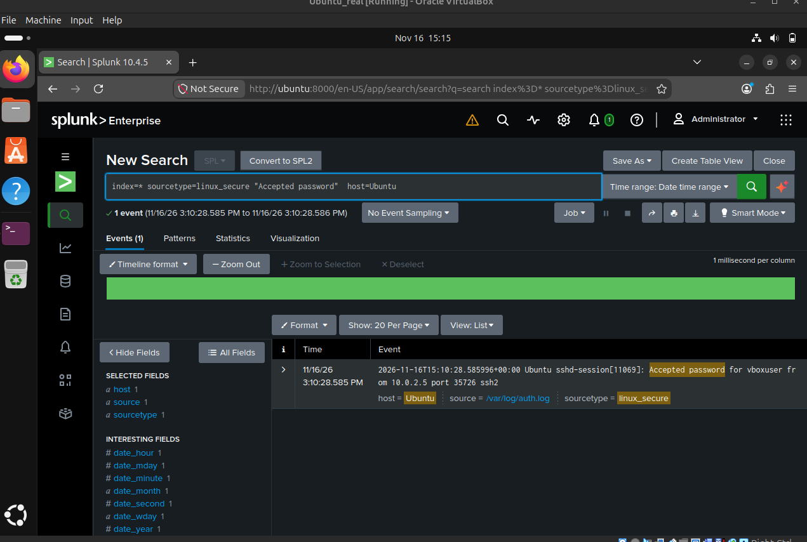
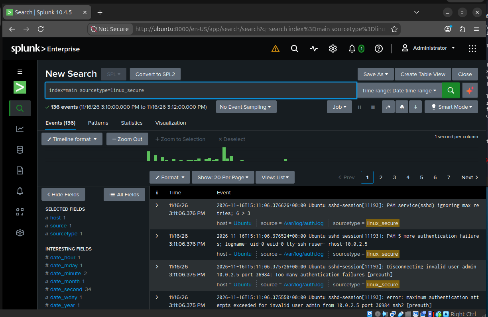

# SSH Authentication Review — Ubuntu Lab

**Environment:** User-operated Ubuntu VirtualBox lab  
**Log source:** `/var/log/auth.log`  
**Splunk sourcetype:** `linux_secure`  
**Splunk host field:** `Ubuntu`  
**Observed date:** 16 November 2026  
**Assessment:** Repeated SSH authentication failures were observed from a lab source address. A separate successful SSH authentication for `vboxuser` is also present in the reviewed time window.

## 1. Scope and evidence

This review is based on four Splunk screenshots supplied from the Ubuntu VirtualBox lab. The original screenshots are embedded below so the observations can be checked against the source evidence.

### Screenshot 1 — Overall Splunk event search


### Screenshot 2 — Accepted SSH password event



### Screenshot 3 — Failed SSH authentication messages


### Screenshot 4 — Authentication log event window




| Screenshot | Search / view | What is visible |
|---|---|---|
| `Accepted(1).png` | `index=*` | 416 events matched in the displayed 30-minute window; events are from `/var/log/auth.log` with sourcetype `linux_secure` |
| `Accepted_Pass.png` | `index=* sourcetype=linux_secure "Accepted password" host=Ubuntu` | One matching event: accepted password for `vboxuser` from `10.0.2.5`, SSH2, source port `35726`, at approximately 15:10:28 UTC |
| `Rejected(1).png` | Event list from the authentication search | Failed password for invalid user `admin` from `10.0.2.5`; failed password for `root`; disconnects during authentication |
| `Rejected_Pass.png` | `index=main sourcetype=linux_secure` | 136 events in the displayed 15:10–15:12 time range; messages include PAM authentication failures, retry-limit messages and SSH connection drops |

The screenshots expose a lab address, `10.0.2.5`, and the SSH server log references `10.0.2.15:22`. These are treated as addresses from the user's virtual lab, not public infrastructure.

## 2. Key observations

### Successful authentication

The targeted Splunk search returned one event matching the exact phrase `Accepted password`:

- Account: `vboxuser`
- Source address: `10.0.2.5`
- Source port: `35726`
- Protocol: SSH2
- Event time: approximately `2026-11-16 15:10:28 UTC`

This confirms that the SSH daemon logged a password authentication success for this account. The screenshot alone does not establish whether the activity was expected or authorized by the account owner.

### Failed authentication activity

The event list shows:

- A failed password for invalid user `admin` from `10.0.2.5`, source port `36984`.
- A failed password for `root` from `10.0.2.5`, source port `36982`.
- PAM messages reporting additional authentication failures.
- An SSH message indicating the maximum authentication attempts were exceeded for the invalid `admin` user.
- SSH connection-drop messages that cite failed authentication.

These messages show repeated unsuccessful SSH authentication activity in the reviewed period. The invalid-user attempt and the root attempt are separate account-name observations; the screenshots do not show that either account was successfully accessed.

## 3. Timeline interpretation

The successful `vboxuser` event is timestamped around 15:10:28 UTC. The visible failed authentication messages occur later, around 15:10:52–15:10:56 UTC, with further PAM/retry-limit messages around 15:11:06 UTC.

**Important:** The successful event appears earlier than the visible failure cluster. The evidence therefore does not support saying that the failed attempts were followed by that successful login. It also does not establish that the successful `vboxuser` session and the later failed attempts were part of one continuous activity.

## 4. Splunk searches used

### Overall event review

```spl
index=*
```

The screenshot shows 416 matching events in the selected 30-minute window. This is a broad search and includes events beyond the SSH activity of interest.

### Locate successful SSH password authentication

```spl
index=* sourcetype=linux_secure "Accepted password" host=Ubuntu
```

The screenshot shows one matching event for `vboxuser`.

### Review Linux authentication events in the selected interval

```spl
index=main sourcetype=linux_secure
```

The screenshot shows 136 events between approximately 15:10 and 15:12 on 16 November 2026.

For a focused review, the following search can be used in the same lab, adjusting the time picker to the relevant interval:

```spl
index=main sourcetype=linux_secure ("Failed password" OR "Accepted password" OR "authentication failure" OR "maximum authentication attempts")
| table _time host source sourcetype _raw
| sort 0 _time
```

This last query is a suggested follow-up search; it is not shown as executed in the supplied screenshots.

## 5. Assessment

**Finding:** The Ubuntu SSH authentication log contains multiple failed authentication messages from `10.0.2.5`, including attempts involving invalid user `admin` and user `root`. A separate successful password authentication for `vboxuser` from the same source address is also visible earlier in the time window.

**Verdict:** Suspicious authentication activity observed; account compromise is not established by the supplied evidence.

**Confidence:** High that the displayed log messages exist; limited regarding intent, ownership and impact.

## 6. What would be checked next

1. Confirm whether the `vboxuser` login at approximately 15:10:28 UTC was expected.
2. Review the complete raw log records and surrounding timestamps, not only the visible rows.
3. Check the SSH session and process records for the relevant time, if collected.
4. Confirm whether `10.0.2.5` is the expected Kali/lab client in this exercise.
5. Check whether any successful authentication occurred for `root` or `admin`; the supplied screenshots do not show one.
6. Preserve the relevant logs and document the lab scope before drawing a final conclusion.

## 7. Limitations

- The report is based on screenshots, not a full export of `auth.log` or the Splunk events.
- Only the visible rows and search counts can be confirmed.
- The broad 416-event and filtered 136-event counts refer to different searches/time selections and should not be treated as counts of failed SSH attempts.
- The screenshots do not prove who operated the source machine or whether the successful `vboxuser` login was authorized.
- No claim is made that an external system or real organization was targeted.

## 8. Conclusion

The Splunk screenshots document SSH authentication failures involving `admin` and `root`, PAM retry-limit messages and a separate accepted password event for `vboxuser`. The correct SOC conclusion is to report the repeated failures as suspicious, validate the successful login with the lab owner, and avoid claiming a successful brute-force compromise without additional evidence.

---
*Prepared from the four original Splunk screenshots supplied for this portfolio. The screenshots are embedded in this report; the written findings are limited to what is visible in them.*